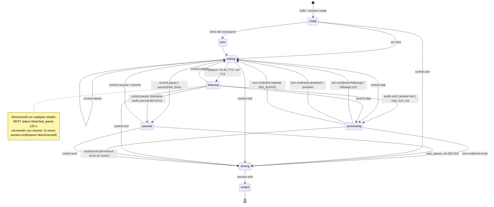
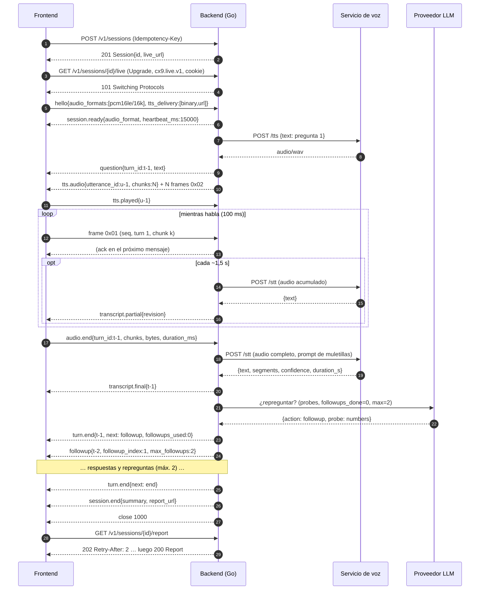

# Contrato del CORTEX-9 Interview Coach (v1)

Ref: CX9-6174 · Estado: **v1.0, estable para empezar a implementar** · Licencia: Apache-2.0

Este documento es el contrato entre las tres partes del repo:

| Parte | Carpeta | Responsable | Rol en el contrato |
|---|---|---|---|
| Backend (Go) | `/backend` | Nexus | Implementa la API REST (§4) y el WebSocket (§5); es **cliente** del servicio de voz (§6) |
| Frontend (React + TS) | `/frontend` | Cronos | Cliente de §4 y §5. Copia los tipos de `docs/ws-types.ts` |
| Voz STT/TTS | `/speech` | Apex | Implementa §6 (`POST /stt`, `POST /tts`, `GET /health`, modo mock) |

Archivos del contrato:

- `docs/contract.md` (este): semántica, diagramas, políticas y ejemplos.
- `docs/openapi.yaml`: OpenAPI 3.1 de la API REST del backend y esquemas `Ws*` de los mensajes del WebSocket. Validado con `openapi-spec-validator`.
- `docs/ws-types.ts`: tipos TypeScript de referencia de los mensajes WS y codificador/decodificador del header binario. Compila con `tsc --strict`.

Si hay contradicción, manda este documento y se corrigen los otros dos en el mismo commit.

Referencia funcional: la versión CLI en Python (`/workspace/interview-sim`): escenarios YAML, repreguntas por *probes*, modo historia con evidencia literal, scoring de 6 dimensiones, versión mejorada sin inventar y "las 3 cosas a practicar".

---

## 1. Alcance: solo práctica (regla de producto, no negociable)

La app **hace de entrevistadora**. El único audio que entra es **la voz del propio usuario respondiendo a preguntas que genera la app**.

**No existe, y el contrato prohíbe agregar:**

1. Ningún endpoint ni mensaje para capturar o transcribir a **un entrevistador real**, audio del sistema, de otra pestaña, de una llamada (Meet, Zoom, Teams, etc.) o de cualquier tercero.
2. Ningún endpoint ni mensaje para **sugerir respuestas en vivo**, "soplar", generar respuestas a preguntas que no hizo la app ni dar devolución mientras la sesión está activa.
3. Ninguna pregunta de entrada libre: las preguntas salen del escenario, del perfil (modo historia) o de repreguntas del motor sobre lo que respondió el usuario. El cliente **no puede** mandar texto de preguntas.

Cómo lo hace cumplir el contrato:

- El WebSocket tiene una **lista cerrada** de tipos (§5.5). Cualquier otro `type` recibe `error` `UNSUPPORTED_MESSAGE` y, si se repite 3 veces, cierre `4400`.
- `transcript.partial` y `transcript.final` son solo de **la respuesta del usuario** al turno actual. No hay campo de sugerencia ni de "respuesta recomendada" en ningún mensaje del servidor durante la sesión.
- El informe (`GET /v1/sessions/{id}/report`) devuelve **409 `SESSION_NOT_ENDED`** mientras la sesión no terminó. La devolución existe solo **al final**.
- El servicio de voz (§6) solo es accesible desde el backend (red interna), nunca desde el navegador.

Un PR que agregue cualquiera de esas capacidades viola este contrato y se rechaza.

---

## 2. Convenciones generales

### 2.1 Versionado

- Prefijo de ruta `/v1`. Cambios compatibles (campos nuevos opcionales, códigos de error nuevos, tipos de mensaje nuevos **del servidor** que el cliente ignora) no cambian la versión.
- Cambios incompatibles → `/v2` y subprotocolo `cx9.live.v2`, conviviendo un tiempo con v1.
- Los clientes **deben ignorar** campos desconocidos. El servidor **rechaza** campos desconocidos en cuerpos REST de escritura (`422`), para atrapar typos.
- WS: campo `v: 1` en el sobre y subprotocolo `cx9.live.v1`.

### 2.2 Formatos

- JSON UTF-8, `snake_case`. Fechas RFC 3339 en UTC (`2026-11-14T07:40:00Z`). Duraciones en milisegundos (`*_ms`) salvo donde se hereda de interview-sim (`duration_s`, `segundos`).
- IDs: sesiones UUIDv7 (ordenables por tiempo); escenarios slug `^[a-z0-9][a-z0-9-]{1,62}$`; turnos `t-<n>` (n = número de turno, desde 1, igual al `turn_no` del header binario); utterances TTS `u-<n>`.
- Idiomas: `es` y `en` (ver `GET /v1/languages`).
- Todas las respuestas llevan `X-Request-Id` (se respeta el que manda el cliente si cumple `^[A-Za-z0-9-]{8,64}$`). El backend lo propaga al servicio de voz y al log.

### 2.3 Errores: RFC 9457 (`application/problem+json`)

```json
{
  "type": "urn:cx9:problem:validation-failed",
  "title": "La petición no pasó la validación",
  "status": 422,
  "detail": "max_followups debe estar entre 0 y 2",
  "instance": "/v1/sessions",
  "code": "VALIDATION_FAILED",
  "request_id": "6f1c2a9e-4b7d",
  "retryable": false,
  "errors": [{ "pointer": "/max_followups", "message": "máximo 2" }]
}
```

- `type` = `urn:cx9:problem:<code en kebab-case>`. `code` es estable y es lo que debe usar el frontend (el `title`/`detail` puede cambiar de redacción).
- Códigos (enum `ErrorCode` en OpenAPI) y su status: `BAD_REQUEST` 400, `VALIDATION_FAILED` 422, `UNAUTHENTICATED` 401, `FORBIDDEN`/`ORIGIN_NOT_ALLOWED`/`READ_ONLY` 403, `NOT_FOUND` 404, `CONFLICT`/`STATE_CONFLICT`/`IDEMPOTENCY_IN_PROGRESS`/`SESSION_NOT_ENDED` 409, `PRECONDITION_FAILED` 412, `PAYLOAD_TOO_LARGE` 413, `UNSUPPORTED_MEDIA_TYPE` 415, `IDEMPOTENCY_KEY_REUSED` 422, `RATE_LIMITED` 429, `INTERNAL` 500, `DEPENDENCY_UNAVAILABLE` 503, `DEPENDENCY_TIMEOUT` 504.
- Nunca se incluyen secretos, claves de API, stack traces ni el texto de las respuestas del usuario en `detail`.

### 2.4 Idempotencia

| Operación | Mecanismo |
|---|---|
| `POST /v1/sessions`, `POST /v1/scenarios` | Header `Idempotency-Key` (recomendado; 8-128 chars `[A-Za-z0-9_-]`). Se guarda 24 h por (método, ruta, clave) con el hash SHA-256 del cuerpo. Misma clave + mismo cuerpo → misma respuesta (mismo status y cuerpo, header `Idempotent-Replayed: true`). Misma clave + otro cuerpo → `422 IDEMPOTENCY_KEY_REUSED`. Primera petición aún en curso → `409 IDEMPOTENCY_IN_PROGRESS` con `Retry-After: 1` |
| `POST /v1/sessions/{id}/end` | Idempotente por naturaleza: si ya terminó, `200` con el mismo cuerpo |
| `PUT`, `PATCH`, `DELETE` | Idempotentes. `PUT`/`PATCH` aceptan `If-Match` con el `ETag` para control de concurrencia (`412` si no coincide) |
| WS | `seq` por dirección; el servidor descarta duplicados (`seq ≤ último procesado`) sin error, lo que hace seguro reenviar tras reconectar |

### 2.5 CORS (solo dev)

En desarrollo el frontend corre en Vite (`http://localhost:5173`) y el backend en `http://127.0.0.1:8080`. La forma recomendada es el **proxy de Vite** (`/v1` → backend, con `ws: true`), que deja todo same-origin y no necesita CORS. Si igual se llama directo:

- `Access-Control-Allow-Origin`: eco exacto de un origen de `CX9_CORS_ORIGINS` (por defecto `http://localhost:5173,http://127.0.0.1:5173`). Nunca `*`, porque hay credenciales.
- `Access-Control-Allow-Credentials: true`
- `Access-Control-Allow-Methods: GET, POST, PUT, PATCH, DELETE, OPTIONS`
- `Access-Control-Allow-Headers: Authorization, Content-Type, Idempotency-Key, If-Match, X-Request-Id`
- `Access-Control-Expose-Headers: ETag, Location, Retry-After, X-Request-Id, Idempotent-Replayed`
- `Access-Control-Max-Age: 600`
- En producción (`CX9_ENV=prod`) CORS está apagado: todo pasa por el mismo origen detrás del proxy de `/deploy`.
- El handshake WS valida `Origin` contra la misma lista (`403 ORIGIN_NOT_ALLOWED`).

### 2.6 Autenticación local (un solo usuario)

- Un único usuario implícito (`local`). La contraseña se configura con `CX9_PASSWORD_HASH` (argon2id) o, en dev, `CX9_DEV_NO_AUTH=1` (solo si el backend escucha en 127.0.0.1; lo registra con un WARN al arrancar).
- `POST /v1/auth/login {"password": "..."}` → `200 {"token","expires_at"}` y `Set-Cookie: cx9_session=<token>; HttpOnly; SameSite=Strict; Path=/; Max-Age=43200` (+`Secure` si no es localhost). Token opaco de 32 bytes aleatorios; en la base se guarda solo su SHA-256.
- El frontend usa la **cookie** (no guarda el token en `localStorage`). `Authorization: Bearer <token>` existe para curl y tests.
- Protección CSRF: `SameSite=Strict` + verificación de `Origin` en métodos de escritura + solo se aceptan cuerpos `application/json`, `application/yaml` o `application/merge-patch+json` (no form posts).
- Login con límite: 5 intentos fallidos por minuto → `429 RATE_LIMITED` con `Retry-After`.
- `POST /v1/auth/logout` revoca el token. `GET /v1/auth/me` devuelve `{"user":"local","expires_at":...}`.

---

## 3. Mapa de rutas

| Método | Ruta | Auth | Descripción |
|---|---|---|---|
| GET | `/v1/health` | no | Liveness |
| GET | `/v1/ready` | no | Readiness (DB, voz, LLM por defecto); `503` si falta algo obligatorio |
| GET | `/metrics` | no (solo red interna) | Prometheus |
| POST | `/v1/auth/login` · `/v1/auth/logout` | – / sí | Login / logout |
| GET | `/v1/auth/me` | sí | Estado de auth |
| GET | `/v1/languages` | sí | Idiomas disponibles |
| GET, POST | `/v1/scenarios` | sí | Listar / crear escenario (YAML o JSON) |
| POST | `/v1/scenarios/validate` | sí | Validar sin guardar |
| GET, PUT, DELETE | `/v1/scenarios/{scenarioId}` | sí | Obtener / reemplazar / borrar (incluidos = solo lectura) |
| GET, POST, PUT, PATCH, DELETE | `/v1/profile` | sí | CRUD del perfil del modo historia |
| GET | `/v1/profile/gaps` | sí | Huecos del perfil |
| GET, POST | `/v1/sessions` | sí | Historial (filtros + cursor) / crear sesión |
| GET, DELETE | `/v1/sessions/{sessionId}` | sí | Detalle con turnos / borrar |
| POST | `/v1/sessions/{sessionId}/end` | sí | Finalizar (idempotente) |
| GET | `/v1/sessions/{sessionId}/report` | sí | Informe (JSON o Markdown) |
| POST | `/v1/sessions/{sessionId}/live-ticket` | sí | Ticket de 60 s para el WS |
| GET (WS) | `/v1/sessions/{sessionId}/live` | cookie o ticket | WebSocket en vivo |
| GET | `/v1/sessions/{sessionId}/tts/{utteranceId}` | sí | Audio TTS si `tts_delivery = url` |
| GET | `/v1/llm/providers` | sí | Proveedores LLM y su estado |

---

## 4. API REST (detalle y ejemplos)

Los esquemas completos están en `openapi.yaml`. Acá va la semántica y un ejemplo por recurso.

### 4.1 Health y métricas

`GET /v1/health` → `200 {"status":"ok","version":"1.0.0"}`.

`GET /v1/ready`:

```json
{
  "status": "degraded",
  "version": "1.0.0",
  "checks": {
    "db": { "status": "ok", "latency_ms": 2 },
    "speech": { "status": "ok", "latency_ms": 11, "detail": "stt=faster-whisper/small tts=piper" },
    "llm:ollama": { "status": "down", "detail": "connection refused; se usará mock" }
  }
}
```

`degraded` responde `200` (la app funciona con fallback); `down` en `db` o `speech` responde `503`.

`GET /metrics` (texto Prometheus). Métricas mínimas que el backend expone:

- `cx9_http_requests_total{method,route,status}` y `cx9_http_request_duration_seconds{method,route}` (histograma)
- `cx9_ws_connections{state}` (gauge), `cx9_ws_messages_total{direction,type}`, `cx9_ws_backpressure_total{action}`
- `cx9_sessions_total{mode,lang,ended_reason}`, `cx9_followups_total{probe}`
- `cx9_speech_request_duration_seconds{op="stt|tts",outcome}`, `cx9_speech_errors_total{op,code}`
- `cx9_llm_request_duration_seconds{provider,outcome}`, `cx9_llm_breaker_state{provider}` (0 closed, 1 half_open, 2 open), `cx9_llm_fallbacks_total{provider}`
- `cx9_report_invented_terms_rejected_total`
- Ninguna etiqueta contiene texto del usuario, IDs de sesión ni claves.

### 4.2 Idiomas

`GET /v1/languages`:

```json
{
  "items": [
    { "code": "es", "name": "Español", "stt": true, "tts_voices": ["es_AR-daniela-high"], "default_voice": "es_AR-daniela-high", "slow_speech": false, "english_feedback": false, "scenarios": 3 },
    { "code": "en", "name": "English", "stt": true, "tts_voices": ["en_US-lessac-medium"], "default_voice": "en_US-lessac-medium", "slow_speech": true, "english_feedback": true, "scenarios": 3 }
  ]
}
```

El backend lo arma con los escenarios cargados y con `GET /voices` del servicio de voz (§6.4). Si el servicio de voz no responde, `stt` y `tts_voices` salen `false`/`[]` (no se inventan).

### 4.3 Escenarios

Mismo esquema que los YAML de interview-sim (`id`, `title.es/en`, `style`, `max_followups` (0-2), `ideal_seconds`, `followup_ideal_seconds`, `intro`, `closing`, `questions[]` con `id`, `text.es/en`, `probes ⊆ {numbers, example, why, ownership, result}`, `keywords`, `star`, `expects_numbers`).

Incluidos (de solo lectura, `builtin: true`), portados de interview-sim:

| id | Qué practica | Preguntas |
|---|---|---|
| `screening-ia` | Primera entrevista con una IA **estilo "Valeria"** (el screening inicial de RRHH hecho por IA de Mercado Libre): recorrido, rol actual, frameworks, tecnologías, problemas resueltos, problema en producción, Node/Go, motivo de cambio, formación, uso de IA. Ritmo calmo, repregunta hasta 2 veces. "Estilo" se refiere al tipo de preguntas y al ritmo; no imita la voz ni la plataforma de ninguna empresa | 10 |
| `behavioral-star` | Conductual STAR | 7 |
| `backend-tecnica` | Técnica backend conversacional | 8 |

- `GET /v1/scenarios?lang=es` → `{"items":[{"id":"screening-ia","title":"Screening con IA (estilo Valeria): …","style":"…","builtin":true,"languages":["es","en"],"question_count":10,"max_followups":2}]}`. Sin `lang`, `title` es el objeto `{es,en}`.
- `GET /v1/scenarios/{id}` con `Accept: application/yaml` devuelve el YAML tal cual; con `application/json`, el objeto.
- `POST /v1/scenarios` con `Content-Type: application/yaml` o `application/json` → `201` + `Location` + `ETag`. Reglas de validación (las de interview-sim): al menos una pregunta, ids de pregunta únicos, `text` con `es` o `en`, probes válidos, `max_followups ≤ 2`. Errores → `422` con `errors[].pointer` (p. ej. `/questions/3/probes/0`). `id` ya existente → `409 CONFLICT`. Máximo 256 KB (`413`). YAML parseado en modo seguro (sin anchors recursivos ni tags custom).
- `PUT`/`DELETE` sobre un escenario incluido → `403 READ_ONLY` (copialo con otro `id`).
- Una sesión copia el escenario al crearse; editarlo después no cambia sesiones existentes.

Ejemplo YAML mínimo:

```yaml
id: mi-screening
title: { es: "Mi screening", en: "My screening" }
max_followups: 2
questions:
  - id: recorrido
    text: { es: "Contame tu recorrido.", en: "Tell me about your background." }
    probes: [example, numbers]
    keywords: [experiencia, años]
    star: false
    expects_numbers: true
```

### 4.4 Perfil del modo historia (CRUD completo)

Hay **un solo perfil**. Estructura (igual que `profile.json` de interview-sim, con evidencia tipada):

```json
{
  "version": 1,
  "updated_at": "2026-11-14T07:40:00Z",
  "experiences": [
    {
      "company": "Telecom",
      "role": "Backend developer",
      "period": "2021-2024",
      "technologies": ["Go", "PostgreSQL"],
      "frameworks": ["Gin"],
      "achievements": ["bajé la latencia del endpoint de facturación"],
      "problems": [],
      "reason_for_change": "",
      "evidence": [{ "quote": "en Telecom trabajé tres años con Go", "session_id": "0193a1b2-...", "turn_id": "t-2" }]
    }
  ],
  "education": [],
  "skills": ["Go"]
}
```

| Operación | Semántica |
|---|---|
| `GET /v1/profile` | `200` + `ETag`; `404` si no existe |
| `POST /v1/profile` | Crea; `409` si ya existe |
| `PUT /v1/profile` | Reemplaza completo (crea si no existe); `If-Match` opcional |
| `PATCH /v1/profile` | JSON Merge Patch (RFC 7396, `application/merge-patch+json`): arrays se reemplazan completos, `null` borra |
| `DELETE /v1/profile` | Borra perfil y evidencia; `204` |
| `GET /v1/profile/gaps?lang=es` | Preguntas para completar huecos: `[{"id":"h-recorrido","company":null,"field":"experiences","text":"Contame tu recorrido profesional, …"}]` |

Reglas anti-invención (heredadas de interview-sim):

- Lo que escribe el usuario a mano por REST se guarda tal cual (es su dato).
- Lo que **extrae el motor** de una sesión (`mode: story` o `learn_profile: true`) solo se guarda si trae una **cita literal** del usuario de al menos 8 caracteres que aparezca en su respuesta; tecnologías y frameworks solo si aparecen en lo que dijo. Lo que no cumple se descarta y se lista en `Report.profile_changes` como descartado.

### 4.5 Sesiones e historial

`POST /v1/sessions` (con `Idempotency-Key`):

```json
{
  "scenario_id": "screening-ia",
  "lang": "es",
  "mode": "practice",
  "input": "voice",
  "llm_provider": "ollama",
  "num_questions": 5,
  "shuffle": false,
  "max_followups": 2,
  "think_pause_ms": 0,
  "learn_profile": false,
  "save_audio": false
}
```

- `mode`: `practice` (requiere `scenario_id`) o `story` (modo historia: las preguntas salen de `/v1/profile/gaps`, `scenario_id` se ignora).
- `input`: `voice` (audio por WS) o `text` (el usuario escribe con `answer.text`; equivale a `--entrada texto`).
- `max_followups`: 0-2; tope duro 2 aunque el escenario diga otra cosa (se usa el menor).
- `llm_provider` por defecto el de `GET /v1/llm/providers`.default. Si el proveedor elegido no está configurado → `422`.

Respuesta `201`:

```json
{
  "id": "0193a1b2-7c4d-7e8f-9a0b-1c2d3e4f5a6b",
  "status": "created",
  "mode": "practice",
  "scenario_id": "screening-ia",
  "scenario_title": "Screening con IA (estilo Valeria): experiencia, frameworks, problemas, tecnologías, motivo de cambio y formación",
  "lang": "es",
  "input": "voice",
  "llm_provider": "ollama",
  "llm_model": "llama3.1",
  "max_followups": 2,
  "question_count": 5,
  "questions_answered": 0,
  "ended_reason": null,
  "overall_score": null,
  "created_at": "2026-11-14T07:40:00Z",
  "started_at": null,
  "ended_at": null,
  "live_url": "/v1/sessions/0193a1b2-7c4d-7e8f-9a0b-1c2d3e4f5a6b/live",
  "report_url": null
}
```

Estados REST (`SessionStatus`):

| Estado | Significado |
|---|---|
| `created` | Creada, nunca se conectó el WS |
| `live` | WS conectado (el sub-estado fino va por WS, §5.6) |
| `detached` | WS caído, dentro de la gracia de reconexión (120 s) |
| `ended` | Terminó; el informe todavía no empezó |
| `scoring` | Calculando el informe |
| `completed` | Informe listo |
| `failed` | El informe falló (el detalle de la sesión sigue disponible) |

Historial: `GET /v1/sessions?status=completed&scenario_id=screening-ia&lang=es&mode=practice&from=2026-11-01T00:00:00Z&to=2026-12-01T00:00:00Z&limit=20&cursor=...&sort=created_at_desc` →

```json
{ "items": [ { "id": "0193a1b2-…", "status": "completed", "overall_score": 3.6, "…": "…" } ], "next_cursor": "eyJjIjoiMjAyNi0xMS0xNFQwNzo0MDowMFoiLCJpZCI6IjAxOTMifQ", "total": 42 }
```

Paginación por cursor opaco (keyset sobre `created_at,id`); `next_cursor: null` = última página. `limit` 1-100 (por defecto 20).

`GET /v1/sessions/{id}` devuelve `SessionDetail` = `Session` + `turns[]` (`id`, `question_id`, `kind: main|followup`, `followup_index`, `probe`, `question`, `answer`, `duration_s`, `duration_estimated`, `low_confidence`, `skipped`) + `llm_errors[]`.

`POST /v1/sessions/{id}/end` (`{"reason":"user"}` opcional): cierra el WS si está abierto (manda `session.end` antes), pasa a `ended` → `scoring`, y devuelve la sesión. Idempotente.

`DELETE /v1/sessions/{id}`: solo si no está `live`/`detached` (`409 STATE_CONFLICT`). Borra turnos, informe y audio.

### 4.6 Informe con scoring

`GET /v1/sessions/{id}/report`:

- `409 SESSION_NOT_ENDED` si la sesión está `created`, `live` o `detached`. **No hay devolución en vivo.**
- `202` + `Retry-After: 2` + cuerpo `Session` mientras está `ended`/`scoring`.
- `200` con `Report` (JSON) o con `Accept: text/markdown`, el `informe.md` equivalente al de interview-sim.

Dimensiones (1 a 5), las mismas de interview-sim: `claridad`, `estructura` (STAR, solo en preguntas `star: true`), `concrecion` (solo si `expects_numbers`), `duracion` (segundos reales del audio vs. `ideal_seconds`; en modo texto, estimados por palabras con `segundos_estimados: true`), `muletillas` (cada 100 palabras), `relevancia`.

**Regla [FALTA] (no inventar datos):**

- Campo de **texto** sin datos → literal `"[FALTA: <qué falta>]"`. Ej.: `"answer": "[FALTA: sin respuesta]"`, `"comment": "[FALTA: el LLM no respondió y la heurística no aplica]"`.
- Campo **numérico** sin datos o que no aplica → `null`, **y** una entrada en `faltantes[]` con el formato `"[FALTA] <JSON path>: <motivo>"`.
- La **versión mejorada** usa solo lo que dijo el usuario; donde falta un dato aparece `[FALTA: …]` en el texto y en `improved.missing[]`. Si el LLM agrega números, tecnologías o nombres propios que el usuario no dijo, se reintenta una vez; si vuelve a pasar se usa `source: "reordenamiento"` (sus propias frases sin muletillas) y los términos van a `rejected_terms[]`. Si no hubo respuesta, `text: "[FALTA: sin respuesta]"`, `source: "falta"`.
- **`top3` tiene exactamente 3 elementos**, ordenados por `rank` 1-3 (las 3 dimensiones con peor promedio, con su consejo). Si hay menos de 3 dimensiones con datos, los lugares sobrantes van con `dimension: "[FALTA]"`, `mean: null`, `advice: "[FALTA: no hay suficientes respuestas para elegir un foco]"`. Nunca se rellena con una dimensión sin datos.

Ejemplo (recortado a un bloque):

```json
{
  "session_id": "0193a1b2-7c4d-7e8f-9a0b-1c2d3e4f5a6b",
  "scenario_id": "screening-ia",
  "scenario_title": "Screening con IA (estilo Valeria): …",
  "lang": "es",
  "mode": "practice",
  "llm": "ollama/llama3.1",
  "started_at": "2026-11-14T07:41:00Z",
  "ended_at": "2026-11-14T07:58:12Z",
  "ended_by_user": false,
  "questions_answered": 5,
  "overall": 3.4,
  "dim_means": { "claridad": 3.8, "estructura": null, "concrecion": 2.0, "duracion": 4.2, "muletillas": 2.6, "relevancia": 4.0 },
  "top3": [
    { "rank": 1, "dimension": "concrecion", "mean": 2.0, "advice": "Prepará 1 número real por experiencia (usuarios, tiempos, % de mejora, tamaño del equipo) y decilo sin que te lo pidan." },
    { "rank": 2, "dimension": "muletillas", "mean": 2.6, "advice": "Reemplazá la muletilla por una pausa en silencio: pensar callado 2 segundos suena seguro, no inseguro." },
    { "rank": 3, "dimension": "claridad", "mean": 3.8, "advice": "Empezá cada respuesta con la idea principal en una frase corta y recién después los detalles." }
  ],
  "blocks": [
    {
      "question_id": "recorrido",
      "question": "Para empezar, contame brevemente tu recorrido profesional.",
      "turns": [
        {
          "turn_id": "t-1",
          "kind": "main",
          "probe": null,
          "question": "Para empezar, contame brevemente tu recorrido profesional.",
          "answer": "Eh, bueno, trabajé en Telecom haciendo backend con Go, o sea, varios años.",
          "dims": { "claridad": 4, "estructura": null, "concrecion": 1, "duracion": 3, "muletillas": 2, "relevancia": 4 },
          "overall": 2.8,
          "score_source": "mixta",
          "comment": "Respuesta clara pero sin magnitudes.",
          "details": { "segundos": 24.6, "segundos_estimados": false, "ideal_segundos": [40, 120], "palabras": 14, "muletillas": ["eh", "bueno,", "o sea"], "muletillas_cada_100": 21.4, "numeros": [], "star": { "S": true, "T": false, "A": true, "R": false } },
          "low_confidence": ["Telecom"]
        },
        {
          "turn_id": "t-2",
          "kind": "followup",
          "probe": "numbers",
          "question": "¿Cuántos años estuviste en Telecom?",
          "answer": "[FALTA: sin respuesta]",
          "dims": { "claridad": null, "estructura": null, "concrecion": null, "duracion": null, "muletillas": null, "relevancia": null },
          "overall": null,
          "score_source": "heuristica",
          "comment": "[FALTA: el usuario saltó la repregunta]",
          "details": { "segundos": 0, "segundos_estimados": true, "ideal_segundos": [15, 75], "palabras": 0, "muletillas": [], "muletillas_cada_100": 0, "numeros": [], "star": { "S": false, "T": false, "A": false, "R": false } },
          "low_confidence": []
        }
      ],
      "improved": {
        "text": "Trabajé en Telecom haciendo backend con Go durante [FALTA: cuántos años].",
        "source": "llm",
        "missing": ["[FALTA: cuántos años]"],
        "rejected_terms": []
      },
      "english": null
    }
  ],
  "profile_changes": [],
  "llm_errors": [],
  "faltantes": [
    "[FALTA] dim_means.estructura: ninguna pregunta de la sesión es STAR",
    "[FALTA] blocks[0].turns[1].dims: el usuario saltó la repregunta"
  ],
  "disclaimer": "Simulador de práctica. Las puntuaciones son orientativas. Las versiones mejoradas usan solo lo que dijiste; donde falta un dato aparece [FALTA: …] para que lo completes con tu dato real."
}
```

En `lang: en`, cada bloque trae `english` (`grammar[]`, `tips[]`, `low_confidence[]`), inferido de la transcripción, no del audio.

### 4.7 Proveedores LLM

`GET /v1/llm/providers`:

```json
{
  "default": "ollama",
  "items": [
    { "id": "openai", "name": "OpenAI", "configured": false, "available": false, "local": false, "default_model": "gpt-4o-mini", "breaker": "closed", "reason": "OPENAI_API_KEY no definida" },
    { "id": "anthropic", "name": "Anthropic", "configured": true, "available": true, "local": false, "default_model": "claude-sonnet", "breaker": "closed", "reason": null },
    { "id": "xai", "name": "xAI", "configured": false, "available": false, "local": false, "default_model": "grok", "breaker": "closed", "reason": "XAI_API_KEY no definida" },
    { "id": "ollama", "name": "Ollama (local)", "configured": true, "available": true, "local": true, "default_model": "llama3.1", "breaker": "closed", "reason": null },
    { "id": "mock", "name": "Mock determinista", "configured": true, "available": true, "local": true, "default_model": "mock", "breaker": "closed", "reason": null }
  ]
}
```

`configured` dice si la clave/URL está definida; **nunca se devuelve su valor**. Los modelos por defecto son configurables por entorno; los de arriba son ejemplos. `local: false` avisa en la UI que el texto de las respuestas sale de la máquina. Si el proveedor de la sesión falla (timeout, breaker abierto), el motor usa la lógica local del `mock` para repreguntar, sigue la sesión y avisa con `error` `LLM_DEGRADED` (no fatal) y en `Report.llm_errors`.

---

## 5. WebSocket de la sesión en vivo: `/v1/sessions/{id}/live`

### 5.1 Handshake y autenticación

1. (Opcional) `POST /v1/sessions/{id}/live-ticket` → `{"ticket":"…","expires_at":"…","url":"/v1/sessions/{id}/live?ticket=…"}`. Ticket de un solo uso, 60 s, atado a la sesión. Sirve si la cookie no viaja (p. ej. puertos distintos sin proxy).
2. `GET /v1/sessions/{id}/live` con `Upgrade: websocket` y `Sec-WebSocket-Protocol: cx9.live.v1`. Auth: cookie `cx9_session` **o** `?ticket=`. Se valida `Origin` (§2.5).
3. Errores **antes** del upgrade son HTTP problem+json: `401`, `403`, `404`, `409` (sesión `ended`/`completed`), `426` (sin subprotocolo).
4. Tras el upgrade, el cliente manda `hello` en ≤ 5 s (si no: `error HELLO_REQUIRED` + cierre `4400`).
5. El servidor responde `session.ready` con el formato de audio elegido, cómo va el TTS, heartbeat y límites. Desde ahí, el servidor conduce: `question` → (`tts.*`) → el usuario responde → `transcript.*` → `turn.end` → `followup` o `question` … → `session.end`.
6. Una sola conexión activa por sesión: una conexión nueva válida reemplaza a la anterior (la vieja recibe cierre `4009 REPLACED`).

### 5.2 Sobre (envelope) JSON

Todo mensaje de texto es un objeto JSON:

```json
{ "v": 1, "type": "question", "seq": 7, "ts": "2026-11-14T07:41:03.120Z", "session_id": "0193a1b2-7c4d-7e8f-9a0b-1c2d3e4f5a6b", "ack": 12, "data": { } }
```

- `seq`: entero ≥ 1, **monótono y sin huecos por dirección** (cliente→servidor y servidor→cliente son contadores independientes). Los **frames binarios consumen `seq`** de la misma secuencia de su dirección.
- `ack` (solo servidor→cliente, opcional en cada mensaje): último `seq` del cliente **procesado de forma contigua**. Lo usa el cliente para backpressure (§5.8) y para reenviar tras reconexión (§5.9).
- `session_id` debe coincidir con la ruta; si no, `error INVALID_MESSAGE`.
- Tamaño máximo de un mensaje de texto: 64 KB.

### 5.3 Formato de audio: decisión

**Decisión: frames binarios con un header propio de 20 bytes; formato base fijo PCM16LE, 16 kHz, mono; Opus opcional por negociación.**

Por qué binario y no base64:

- base64 agrega +33 % de bytes y CPU de codificar/decodificar en cada chunk; a 16 kHz PCM16 son 32 KB/s → ~43 KB/s en base64.
- El navegador ya entrega `ArrayBuffer` (AudioWorklet → `Int16Array`), y `gorilla/websocket`/`nhooyr` en Go reciben `[]byte` sin copia extra.
- El header lleva `seq`, turno e índice de chunk, así el audio participa del mismo orden, ack y reenvío que el JSON.
- Existe un **fallback JSON** `audio.chunk` con `audio_b64` solo para clientes que no puedan mandar binarios (tests rápidos con herramientas de texto). No es el camino normal.

Por qué PCM16 16 kHz mono como base:

- Es exactamente lo que consume Whisper (16 kHz mono): el servicio de voz no tiene que re-muestrear ni decodificar, y la duración se calcula exacta (`bytes / 32000` s), que es lo que usa la dimensión `duracion`.
- Es trivial de producir en el navegador (AudioWorklet + downsample 48k→16k) y de testear (archivos .raw deterministas).
- Costo: 32 KB/s ≈ 256 kbps, irrelevante en localhost (la app es local).

Negociación: el cliente lista en `hello.data.audio_formats` lo que puede mandar, en orden de preferencia, e **incluye siempre** `{"codec":"pcm16le","sample_rate":16000,"channels":1}`. El servidor elige y lo confirma en `session.ready.data.audio_format`. En v1 el backend acepta `opus` (48 kHz mono, paquetes Opus crudos de 20 ms, uno o varios por frame) solo si el servicio de voz declara soporte en `/health`; si no, elige PCM16. Si el cliente no ofrece PCM16 ni un formato soportado → `error UNSUPPORTED_FORMAT` fatal.

Chunks: recomendado 100 ms (3200 bytes PCM16); permitido 20-1000 ms; `payload_len ≤ 32000` bytes.

### 5.4 Header binario (20 bytes, big-endian / orden de red)

| Offset | Tipo | Campo | Valor |
|---|---|---|---|
| 0 | u8[2] | magic | `0x43 0x58` ("CX") |
| 2 | u8 | version | `1` |
| 3 | u8 | kind | `0x01` audio.chunk (cliente→servidor) · `0x02` tts.audio (servidor→cliente) |
| 4 | u32 | seq | seq de esa dirección (comparte contador con el JSON) |
| 8 | u32 | turn_no | cliente: nº de turno (`turn_id = "t-" + turn_no`) · servidor: nº de utterance (`utterance_id = "u-" + n`) |
| 12 | u32 | chunk_index | desde 0 dentro del turno/utterance, sin huecos |
| 16 | u8 | codec | `0x01` pcm16le@16k · `0x02` opus@48k · `0x03` wav (solo TTS) |
| 17 | u8 | flags | bit0 = último chunk; resto en 0 |
| 18 | u16 | payload_len | bytes de payload (≤ 32000); debe ser `len(frame) − 20` |

PCM16 va en **little-endian** dentro del payload (el header es big-endian; son cosas distintas). Un frame mal formado → `error INVALID_MESSAGE` (no fatal la primera vez; 3 seguidos → cierre `4400`). `encodeFrame`/`decodeFrame` de referencia en `docs/ws-types.ts`.

### 5.5 Mensajes (lista cerrada)

**Cliente → servidor**

| type | Cuándo | data |
|---|---|---|
| `hello` | Primer mensaje | `client`, `audio_formats[]`, `tts_delivery[]` (`binary`/`url`/`none`), `tts_formats[]`, `partials`, `resume{last_server_seq}` |
| *(binario kind 0x01)* `audio.chunk` | Mientras el usuario habla, solo en estado `listening` | header §5.4 + PCM16 |
| `audio.chunk` (JSON, fallback) | Igual, si no puede binario | `turn_id`, `chunk_index`, `audio_b64` |
| `audio.end` | Fin del turno de voz (VAD del cliente o push-to-talk) | `turn_id`, `chunks`, `bytes`, `duration_ms` |
| `answer.text` | Respuesta escrita (sesiones `input: text`) | `turn_id`, `text` (≤ 8000) |
| `control.pause` | Pausar | `turn_id?` |
| `control.resume` | Reanudar | `turn_id?` |
| `control.skip` | Saltar la pregunta actual (y sus repreguntas) | `turn_id` |
| `control.repeat` | Repetir la pregunta actual (como `/repetir`) | `turn_id` |
| `control.end` | Terminar la sesión y armar el informe con lo respondido | `{}` |
| `tts.played` | Terminó de reproducir una intervención (el servidor pasa a `listening`) | `utterance_id` |
| `ping` / `pong` | Heartbeat de aplicación | `nonce` |

**Servidor → cliente**

| type | Cuándo | data |
|---|---|---|
| `session.ready` | Respuesta a `hello` | `state`, `audio_format`, `tts_delivery`, `tts_format`, `heartbeat_ms` (15000), `idle_timeout_ms` (45000), `max_inflight_bytes`, `max_turn_ms`, `resumed`, `last_client_seq`, `question_index`, `question_count` |
| `question` | Nueva pregunta principal (también intro/cierre/repetición con `kind`) | `turn_id`, `question_id`, `index`, `total`, `text`, `lang`, `utterance_id`, `kind` |
| `followup` | Repregunta | `turn_id`, `question_id`, `followup_index` (1 o 2), `max_followups` (≤ 2), `probe`, `text`, `utterance_id` |
| `tts.audio` | Audio de la intervención por WS; le siguen `chunks` frames binarios kind 0x02 | `utterance_id`, `format`, `sample_rate`, `duration_ms`, `chunks`, `bytes`, `sha256?` |
| `tts.url` | Alternativa: el cliente baja el audio por HTTP | `utterance_id`, `url`, `format`, `duration_ms`, `expires_at` |
| `transcript.partial` | Transcripción parcial de la respuesta del usuario | `turn_id`, `text`, `revision`, `audio_ms` |
| `transcript.final` | Transcripción final del turno | `turn_id`, `text`, `duration_ms`, `confidence`, `low_confidence[]`, `source` (`stt`/`text`) |
| `pause` | Pausa (pedida, tiempo para pensar o reconexión) | `reason`, `resume_after_ms?`, `max_pause_ms` |
| `resume` | Fin de la pausa | `state` |
| `turn.end` | Cierre del turno con qué sigue | `turn_id`, `reason`, `next` (`followup`/`question`/`repeat`/`end`), `followups_used`, `max_followups` |
| `session.end` | Fin de la sesión con resumen | `reason`, `report_url`, `summary{questions_asked, questions_answered, followups_asked, skipped, total_answer_ms, report_status}` |
| `error` | Error | `code`, `message`, `fatal`, `retryable`, `ref_seq?`, `close_code?` |
| `ping` / `pong` | Heartbeat | `nonce` |

Reglas del motor que el cliente puede asumir:

- **Una pregunta por turno.** Nunca llegan dos `question`/`followup` sin un `turn.end` en el medio.
- **Repreguntas: máximo 2 por pregunta.** `followup_index` es 1 o 2; `followups_used` en `turn.end` cuenta las ya hechas. Con `max_followups` 0 no hay repreguntas. El tope lo impone el servidor.
- `transcript.partial` es opcional (si `hello.partials=false` no se manda) y **no** es una sugerencia: es la propia voz del usuario. Se genera re-transcribiendo el audio acumulado con `POST /stt` cada ~1,5 s mientras dura el turno (el servicio de voz no es streaming); `revision` crece y cada parcial **reemplaza** al anterior. El final siempre llega y es el que cuenta.
- Si el audio del turno es silencio o la transcripción queda vacía: `error NO_AUDIO` (no fatal), `turn.end{reason:"no_audio", next:"repeat"}` y `question{kind:"repeat"}` con "No te escuché bien. ¿Podés repetir tu respuesta?" (sin consumir repreguntas).
- `max_turn_ms` (por defecto 300000): al superarlo el servidor cierra el turno como si hubiera llegado `audio.end` (`turn.end.reason = "max_duration"`) y descarta chunks posteriores de ese turno.

### 5.6 Diagrama de estados de la sesión (WS)



### 5.7 Diagrama de secuencia (turno con repregunta)



### 5.8 Backpressure

Cliente → servidor (audio):

- `session.ready.data.max_inflight_bytes` (por defecto 96000 ≈ 3 s de PCM16) es la ventana: bytes de audio enviados con `seq > ack` no pueden superarla.
- El cliente además mira `WebSocket.bufferedAmount`: si supera `max_inflight_bytes`, deja de mandar y **acumula localmente** (no descarta: el audio es la respuesta del usuario), y reanuda cuando baja.
- Si el servidor tiene más de 2 × ventana sin procesar de esa conexión, manda `error BACKPRESSURE` (no fatal, `retryable: true`); si persiste 10 s, cierra con `4008`. El cliente reconecta con resume y reenvía lo no confirmado.
- Si el STT va lento, el servidor sigue aceptando (dentro de la ventana) y retrasa `transcript.final`; nunca descarta audio aceptado.

Servidor → cliente:

- Cola de salida acotada por conexión (256 mensajes o 1 MB). Si se llena: primero se **fusionan los `transcript.partial`** (se manda solo el último), después se pausa el envío de frames TTS (el cliente puede pedir `tts.url`). `question`, `followup`, `transcript.final`, `turn.end`, `session.end` y `error` **nunca se descartan**. Si aun así se llena → cierre `4008` y el cliente reconecta con resume.

### 5.9 Heartbeat, timeouts y reconexión con resume

Heartbeat (intervalo fijo, informado en `session.ready`):

- `heartbeat_ms = 15000`: el **servidor** manda ping de control WebSocket (RFC 6455; el navegador responde solo) **y** el **cliente** manda `ping{nonce}` JSON cada 15 s (los navegadores no pueden mandar pings de control); el servidor responde `pong{nonce}` con el mismo nonce. El servidor también puede mandar `ping` JSON y el cliente debe responder `pong`.
- `idle_timeout_ms = 45000`: si el servidor no recibe nada (ni pong de control, ni JSON, ni binario) en 45 s, cierra `4011`. Si el cliente no recibe nada en 45 s, considera la conexión muerta y reconecta.
- `ping`/`pong` consumen `seq` como cualquier mensaje.

Reconexión:

- Al caerse el WS la sesión pasa a `detached` (REST) y se mantiene **120 s** (`RECONNECT_GRACE_MS`). El temporizador de la pregunta se congela (equivale a `pause{reason:"reconnect"}`).
- El cliente reconecta con backoff exponencial con jitter: 0,5 s, 1 s, 2 s, 4 s, 8 s (tope 8 s) hasta agotar la gracia.
- En el nuevo `hello` manda `resume: {"last_server_seq": N}` (el último `seq` del servidor que procesó).
- El servidor guarda un buffer de reenvío de los **últimos 512 mensajes o 60 s** por sesión (incluye frames TTS). Si tiene todo desde `N+1`, contesta `session.ready{resumed:true, last_client_seq:M}` y **reenvía** los mensajes `seq > N` con su `seq` original. Si no los tiene, `error RESUME_GAP` (no fatal) y `session.ready{resumed:false}` seguido del estado actual (la pregunta vigente se reenvía como `question` o `followup`).
- `last_client_seq: M` le dice al cliente qué recibió el servidor: el cliente **reenvía sus mensajes `seq > M`** (incluido el audio guardado). El servidor ignora duplicados.
- La secuencia del servidor **no se reinicia** al reconectar; la del cliente tampoco (sigue desde su último seq).
- Si vence la gracia: la sesión termina con `ended_reason: "disconnected"` y el informe se arma con lo respondido.

### 5.10 Pausas

- `control.pause` en `asking`/`listening`: el servidor confirma con `pause{reason:"user", max_pause_ms:1800000}`. Si estaba en `listening`, el audio parcial del turno se descarta y al reanudar se repite la pregunta (`question{kind:"repeat"}` o el `followup` vigente) sin contar repregunta.
- `think_pause_ms` (de la sesión): antes de cada pregunta el servidor manda `pause{reason:"think_time", resume_after_ms}` y luego `resume` solo.
- `control.resume` → `resume{state}`. Pausa > 30 min → `session.end{reason:"timeout"}`.
- `control.pause`/`control.resume` en estados donde no aplican → `error STATE_CONFLICT` (no fatal).

### 5.11 Errores WS y códigos de cierre

| code | fatal | retryable | Cuándo |
|---|---|---|---|
| `AUTH_FAILED` | sí (4001) | no | Ticket o cookie inválidos tras el upgrade |
| `SESSION_NOT_FOUND` | sí (4004) | no | |
| `SESSION_ENDED` | sí (4010) | no | La sesión ya terminó |
| `ALREADY_CONNECTED` | sí (4009) | no | A la conexión vieja, cuando otra la reemplaza |
| `HELLO_REQUIRED` | sí (4400) | sí | No llegó `hello` en 5 s, o llegó otro tipo antes |
| `INVALID_MESSAGE` | no (3 seguidos: 4400) | no | JSON inválido, campo faltante, frame binario mal formado |
| `UNSUPPORTED_MESSAGE` | no (3 seguidos: 4400) | no | `type` fuera de la lista cerrada (§1) |
| `UNSUPPORTED_FORMAT` | sí (4400) | no | Ningún formato de audio aceptable |
| `SEQ_OUT_OF_ORDER` | no | sí | Hueco en `seq` del cliente; el servidor indica el esperado en `ref_seq` y el cliente reenvía desde ahí |
| `RESUME_GAP` | no | no | No se pudo reenviar desde `last_server_seq` |
| `STATE_CONFLICT` | no | no | Mensaje válido pero no en este estado (p. ej. audio fuera de `listening`) |
| `BACKPRESSURE` | no (persistente: 4008) | sí | §5.8 |
| `AUDIO_TOO_LONG` | no | no | Turno > `max_turn_ms` |
| `NO_AUDIO` | no | sí | Silencio o transcripción vacía |
| `STT_UNAVAILABLE` / `STT_TIMEOUT` | no | sí | El servicio de voz falló tras el reintento; `turn.end{next:"repeat"}` |
| `TTS_UNAVAILABLE` | no | sí | Llega `question` sin audio; el frontend muestra el texto |
| `LLM_DEGRADED` | no | no | Se usa la lógica local de repreguntas |
| `INTERNAL` | sí (4500) | sí | |

Cierres: `1000` normal (tras `session.end`), `4001`, `4003` (Origin), `4004`, `4008`, `4009`, `4010`, `4011` (idle), `4400` (protocolo), `4500`. Antes de un cierre propio el servidor manda `error` con `fatal: true` y `close_code`.

### 5.12 Ejemplos de cada mensaje

Los ejemplos omiten `v`, `ts` y `session_id` cuando no aportan; en el cable **siempre** van.

```json
{"v":1,"type":"hello","seq":1,"ts":"2026-11-14T07:41:00.000Z","session_id":"0193a1b2-7c4d-7e8f-9a0b-1c2d3e4f5a6b","data":{"client":"cx9-frontend/0.1.0","audio_formats":[{"codec":"pcm16le","sample_rate":16000,"channels":1,"frame_ms":100}],"tts_delivery":["binary","url"],"tts_formats":["wav","pcm16le"],"partials":true,"resume":null}}
```
```json
{"v":1,"type":"session.ready","seq":1,"ts":"2026-11-14T07:41:00.020Z","session_id":"0193a1b2-7c4d-7e8f-9a0b-1c2d3e4f5a6b","ack":1,"data":{"state":"ready","audio_format":{"codec":"pcm16le","sample_rate":16000,"channels":1,"frame_ms":100},"tts_delivery":"binary","tts_format":"wav","heartbeat_ms":15000,"idle_timeout_ms":45000,"max_inflight_bytes":96000,"max_turn_ms":300000,"resumed":false,"last_client_seq":1,"question_index":0,"question_count":5}}
```
```json
{"type":"question","seq":2,"data":{"turn_id":"t-1","question_id":"recorrido","index":1,"total":5,"text":"Para empezar, contame brevemente tu recorrido profesional.","lang":"es","utterance_id":"u-1","kind":"main"}}
```
```json
{"type":"tts.audio","seq":3,"data":{"utterance_id":"u-1","format":"wav","sample_rate":22050,"duration_ms":3420,"chunks":5,"bytes":150844,"sha256":"9f2c…"}}
```
Frames binarios siguientes: `43 58 01 02 | 00 00 00 04 | 00 00 00 01 | 00 00 00 00 | 03 | 00 | 7D 00` + 32000 bytes … el último con `flags=01`. Consumen `seq` 4-8.
```json
{"type":"tts.url","seq":4,"data":{"utterance_id":"u-1","url":"/v1/sessions/0193a1b2-7c4d-7e8f-9a0b-1c2d3e4f5a6b/tts/u-1","format":"wav","duration_ms":3420,"expires_at":"2026-11-14T08:41:00Z"}}
```
```json
{"type":"tts.played","seq":2,"data":{"utterance_id":"u-1"}}
```
Audio del cliente (100 ms, turno 1, chunk 0, seq 3): `43 58 01 01 | 00 00 00 03 | 00 00 00 01 | 00 00 00 00 | 01 | 00 | 0C 80` + 3200 bytes PCM16LE.
```json
{"type":"audio.chunk","seq":3,"data":{"turn_id":"t-1","chunk_index":0,"audio_b64":"AAABAAIA…"}}
```
```json
{"type":"transcript.partial","seq":9,"ack":18,"data":{"turn_id":"t-1","text":"Eh, bueno, trabajé en Telecom","revision":1,"audio_ms":1600}}
```
```json
{"type":"audio.end","seq":250,"data":{"turn_id":"t-1","chunks":246,"bytes":787200,"duration_ms":24600}}
```
```json
{"type":"transcript.final","seq":14,"ack":250,"data":{"turn_id":"t-1","text":"Eh, bueno, trabajé en Telecom haciendo backend con Go, o sea, varios años.","duration_ms":24600,"confidence":0.87,"low_confidence":["Telecom"],"source":"stt"}}
```
```json
{"type":"answer.text","seq":5,"data":{"turn_id":"t-1","text":"Trabajé tres años en Telecom como backend developer."}}
```
```json
{"type":"turn.end","seq":15,"data":{"turn_id":"t-1","reason":"audio_end","next":"followup","followups_used":0,"max_followups":2}}
```
```json
{"type":"followup","seq":16,"data":{"turn_id":"t-2","question_id":"recorrido","followup_index":1,"max_followups":2,"probe":"numbers","text":"¿Cuántos años estuviste en Telecom?","utterance_id":"u-2"}}
```
```json
{"type":"control.pause","seq":260,"data":{"turn_id":"t-2"}}
```
```json
{"type":"pause","seq":20,"data":{"reason":"user","resume_after_ms":null,"max_pause_ms":1800000}}
```
```json
{"type":"control.resume","seq":261,"data":{"turn_id":"t-2"}}
```
```json
{"type":"resume","seq":21,"data":{"state":"asking"}}
```
```json
{"type":"control.skip","seq":262,"data":{"turn_id":"t-2"}}
```
```json
{"type":"control.repeat","seq":263,"data":{"turn_id":"t-3"}}
```
```json
{"type":"control.end","seq":300,"data":{}}
```
```json
{"type":"session.end","seq":60,"data":{"reason":"user","report_url":"/v1/sessions/0193a1b2-7c4d-7e8f-9a0b-1c2d3e4f5a6b/report","summary":{"questions_asked":3,"questions_answered":2,"followups_asked":2,"skipped":1,"total_answer_ms":81200,"report_status":"scoring"}}}
```
```json
{"type":"error","seq":22,"data":{"code":"STT_TIMEOUT","message":"El servicio de voz no respondió a tiempo. Repetí tu respuesta.","fatal":false,"retryable":true,"ref_seq":250,"close_code":null}}
```
```json
{"type":"ping","seq":120,"data":{"nonce":"c1"}}
```
```json
{"type":"pong","seq":45,"data":{"nonce":"c1"}}
```
Reconexión:
```json
{"type":"hello","seq":301,"data":{"client":"cx9-frontend/0.1.0","audio_formats":[{"codec":"pcm16le","sample_rate":16000,"channels":1}],"tts_delivery":["binary"],"partials":true,"resume":{"last_server_seq":44}}}
```
```json
{"type":"session.ready","seq":46,"ack":298,"data":{"state":"listening","audio_format":{"codec":"pcm16le","sample_rate":16000,"channels":1,"frame_ms":100},"tts_delivery":"binary","heartbeat_ms":15000,"idle_timeout_ms":45000,"max_inflight_bytes":96000,"max_turn_ms":300000,"resumed":true,"last_client_seq":298,"question_index":3,"question_count":5}}
```
(Después el servidor reenvía su `seq 45`, y el cliente reenvía sus `seq 299-300`.)

### 5.13 Tipos TypeScript

Copiar `docs/ws-types.ts` (union `ClientMessage` / `ServerMessage` discriminada por `type`, constantes `HEARTBEAT_MS`, `IDLE_TIMEOUT_MS`, `RECONNECT_GRACE_MS`, `CloseCode`, y `encodeFrame`/`decodeFrame`). Extracto:

```ts
export interface Envelope<T extends string, D> { v: 1; type: T; seq: number; ts: string; session_id: string; ack?: number; data: D; }
export type Followup = Envelope<"followup", { turn_id: string; question_id: string; followup_index: 1 | 2; max_followups: 0 | 1 | 2; probe: Probe; text: string; utterance_id: string }>;
export type ServerMessage = SessionReady | Question | Followup | TtsAudio | TtsUrl | TranscriptPartial | TranscriptFinal | Pause | Resume | TurnEnd | SessionEnd | WsError | Ping | Pong;
export type ClientMessage = Hello | AudioChunkJson | AudioEnd | AnswerText | ControlPause | ControlResume | ControlSkip | ControlEnd | ControlRepeat | TtsPlayed | Ping | Pong;
```

---

## 6. Contrato HTTP backend → servicio de voz (`/speech`)

- Base URL: `CX9_SPEECH_URL` (por defecto `http://speech:8090` en compose, `http://127.0.0.1:8090` sin Docker). **Solo red interna**; el navegador nunca lo llama.
- Sin auth en la red interna de compose; si se expone fuera, `Authorization: Bearer $CX9_SPEECH_TOKEN` (el backend lo manda si está definido).
- Errores en `application/problem+json` (mismo formato §2.3). Header `X-Request-Id` propagado.
- Las dos operaciones son **funciones puras** del input → reintentar es seguro.

### 6.1 `POST /stt`

Petición: **cuerpo binario crudo** (no multipart, para no copiar el audio dos veces).

| Elemento | Valor |
|---|---|
| `Content-Type` | `audio/L16; rate=16000; channels=1` (PCM16LE 16 kHz mono, **el formato base**) · `audio/wav` (PCM16 mono, cualquier rate; se re-muestrea) · `audio/ogg; codecs=opus` (opcional; declarado en `/health`) |
| Query `language` | `es` \| `en` \| `auto` (obligatorio; el backend manda el de la sesión) |
| Query `word_confidence` | `true` (por defecto) devuelve palabras con confianza |
| Query `prompt` | Opcional, URL-encoded, ≤ 500 chars: prompt inicial para conservar muletillas (el de interview-sim: `"Eh, bueno, este... o sea, digamos que, mmm, trabajé en backend."`) |
| Query `partial` | `true` si es una re-transcripción parcial: el servicio puede usar un modelo/beam más rápido |
| Límites | máx. 600 s de audio o 20 MB → `413`; 0 bytes o < 100 ms → `422` `NO_AUDIO` |

Respuesta `200 application/json`:

```json
{
  "text": "Eh, bueno, trabajé en Telecom haciendo backend con Go, o sea, varios años.",
  "language": "es",
  "duration_s": 24.6,
  "confidence": 0.87,
  "segments": [
    {
      "start_s": 0.0, "end_s": 4.1, "text": "Eh, bueno, trabajé en Telecom", "confidence": 0.82,
      "words": [
        { "word": "Eh,", "start_s": 0.0, "end_s": 0.3, "confidence": 0.95 },
        { "word": "Telecom", "start_s": 3.4, "end_s": 4.1, "confidence": 0.41 }
      ]
    }
  ],
  "engine": "faster-whisper",
  "model": "small",
  "processing_ms": 1830
}
```

- `duration_s`: duración real del audio recibido (para PCM16 16 kHz = `bytes / 32000`), no la del habla.
- `confidence` 0-1: promedio de `confidence` de las palabras ponderado por duración (`null` si el motor no la da). El backend marca `low_confidence` las palabras con `confidence < 0.5` y longitud > 2 (regla de interview-sim).
- `segments[].words` vacío si `word_confidence=false`.

### 6.2 `POST /tts`

Petición `application/json`:

```json
{ "text": "Para empezar, contame brevemente tu recorrido profesional.", "language": "es", "voice": "es_AR-daniela-high", "format": "wav", "sample_rate": 22050, "speed": 1.0 }
```

| Campo | Regla |
|---|---|
| `text` | 1-2000 chars (`422` si no) |
| `language` | `es` \| `en` |
| `voice` | Opcional; id de `GET /voices`. Si falta, la voz por defecto del idioma. Desconocida → `422` `VOICE_NOT_FOUND` |
| `format` | `wav` (por defecto) \| `pcm16le` \| `opus` (si `/health` lo declara) |
| `sample_rate` | Opcional; por defecto la nativa de la voz |
| `speed` | 0.5-2.0; el backend manda 0.85 en `en` (habla más lento, como interview-sim) |

Respuesta `200` con el audio en el cuerpo:

- `Content-Type`: `audio/wav` · `audio/L16; rate=<sr>; channels=1` · `audio/ogg; codecs=opus`
- Headers: `X-Audio-Duration-Ms`, `X-Sample-Rate`, `X-Voice`, `X-Engine` (`piper`/`espeak-ng`/`mock`)

### 6.3 `GET /health`

```json
{
  "status": "ok",
  "version": "1.0.0",
  "mode": "real",
  "stt": { "ready": true, "engine": "faster-whisper", "model": "small", "languages": ["es", "en"], "input_formats": ["audio/L16;rate=16000;channels=1", "audio/wav"] },
  "tts": { "ready": true, "engine": "piper", "fallback": "espeak-ng", "output_formats": ["wav", "pcm16le"] }
}
```

`status`: `ok` | `degraded` (p. ej. TTS cayó a espeak) | `down` (`503`). El backend lo usa para `/v1/ready`, para decidir si acepta Opus y para `GET /v1/languages`.

### 6.4 `GET /voices`

```json
{ "items": [ { "id": "es_AR-daniela-high", "language": "es", "engine": "piper", "default": true }, { "id": "en_US-lessac-medium", "language": "en", "engine": "piper", "default": true } ] }
```

### 6.5 Timeouts y reintentos (lado backend)

| Operación | Connect | Timeout total | Reintentos |
|---|---|---|---|
| `POST /stt` final | 2 s | `min(60 s, 10 s + 0,5 × duración del audio)` | 1 reintento con backoff 300 ms ± 100 ms ante error de conexión, `502`, `503`, `504`. Nunca ante `4xx` |
| `POST /stt` parcial | 2 s | 5 s | 0 (se descarta el parcial; no se reintenta) |
| `POST /tts` | 2 s | 15 s | 1 reintento como STT |
| `GET /health` | 1 s | 2 s | 0 |

- Si se agotan: STT → `error STT_TIMEOUT`/`STT_UNAVAILABLE` en el WS y se pide repetir la respuesta (el audio del turno se conserva hasta que se transcriba o se descarte el turno). TTS → `error TTS_UNAVAILABLE` y la pregunta va solo como texto.
- Circuit breaker por operación: abre con 5 fallos seguidos, half-open a los 30 s.
- El servicio de voz debe responder `503` + `Retry-After` si está cargando el modelo (al arrancar).

### 6.6 Errores del servicio de voz

| status | code | Cuándo |
|---|---|---|
| 400 | `BAD_REQUEST` | Query o JSON mal formado |
| 413 | `PAYLOAD_TOO_LARGE` | > 600 s o > 20 MB |
| 415 | `UNSUPPORTED_MEDIA_TYPE` | Content-Type de audio no soportado |
| 422 | `NO_AUDIO` / `VALIDATION_FAILED` / `VOICE_NOT_FOUND` / `UNSUPPORTED_LANGUAGE` | |
| 500 | `INTERNAL` | |
| 503 | `MODEL_LOADING` / `DEPENDENCY_UNAVAILABLE` | Con `Retry-After` |

### 6.7 Modo mock determinista (tests sin red ni modelos)

Se activa con `CX9_SPEECH_MODE=mock` al arrancar el servicio (`/health` devuelve `"mode":"mock"`). No carga modelos ni abre conexiones salientes. Mismas rutas, mismos esquemas, resultados **idénticos byte a byte** para la misma entrada:

`POST /stt` mock:

- Si viene el header `X-Mock-Transcript: <texto URL-encoded>`, devuelve ese texto (así los tests e2e controlan respuestas, con muletillas y números).
- Si no, `text = "respuesta simulada " + primeros 8 hex del SHA-256 del cuerpo` (`"simulated answer …"` si `language=en`).
- `duration_s = bytes / 32000` para L16 16 kHz (o la del header WAV), redondeado a 3 decimales.
- Un único segmento `[0, duration_s]`; palabras = `text` separado por espacios, con tiempos repartidos uniformemente y `confidence = 0.9`, salvo palabras que empiezan con `?` (p. ej. `?Telecom`), que van con `0.3` y sin el `?` (para probar `low_confidence`).
- `confidence` = promedio; `engine: "mock"`, `model: "mock"`, `processing_ms: 0`.
- Audio vacío o < 100 ms → `422 NO_AUDIO` (igual que real). Header `X-Mock-Fail: 503|504|timeout` fuerza el error para probar reintentos y breaker (`timeout` = no responde hasta que corte el cliente).

`POST /tts` mock:

- Devuelve **silencio** PCM16 (todos ceros) en el formato pedido, a 16000 Hz, con duración `300 + 60 × (nº de palabras de text)` ms. `X-Engine: mock`. Mismo texto → mismos bytes (y mismo `sha256`).

`GET /voices` mock: `mock-es` y `mock-en`.

El backend tiene su **propio fake** en Go que implementa este mismo contrato en memoria (`httptest.Server`) para los tests de `/backend`, y los tests de contrato de `/speech` validan las respuestas mock contra los ejemplos de esta sección.

---

## 7. Datos y privacidad (lo que el contrato fija)

- El audio de las respuestas no se guarda salvo `save_audio: true` (equivale a `--guardar-audio`). Si se guarda, queda en el volumen local y se borra con la sesión.
- Ningún mensaje, log ni métrica incluye claves de API. Los logs estructurados (JSON) no incluyen el texto de las respuestas salvo con `CX9_LOG_TRANSCRIPTS=1` (dev).
- Con `ollama`/`mock` y el servicio de voz local, nada sale de la máquina. Con `openai`/`anthropic`/`xai`, sale el **texto** de las respuestas (no el audio) hacia ese proveedor; la UI lo avisa usando `LlmProvider.local`.

---

## 8. Checklist de conformidad (para tests de contrato)

- [ ] `openapi.yaml` valida (OpenAPI 3.1) y el backend responde con esos esquemas (test de contrato en `/backend`).
- [ ] El WS rechaza todo `type` fuera de §5.5 con `UNSUPPORTED_MESSAGE`.
- [ ] `GET /report` devuelve `409 SESSION_NOT_ENDED` con la sesión `live`.
- [ ] Nunca hay más de 2 `followup` por `question_id`; `followup_index ∈ {1,2}`.
- [ ] `top3` siempre tiene 3 elementos; numéricos sin datos son `null` y aparecen en `faltantes`.
- [ ] Resume: tras cortar y reconectar con `last_server_seq`, el cliente recibe los mensajes faltantes con su `seq` original y sin duplicar turnos.
- [ ] El mock de voz da la misma salida para la misma entrada.
- [ ] Header binario: `decodeFrame(encodeFrame(h, p))` es identidad; `payload_len` inconsistente se rechaza.
